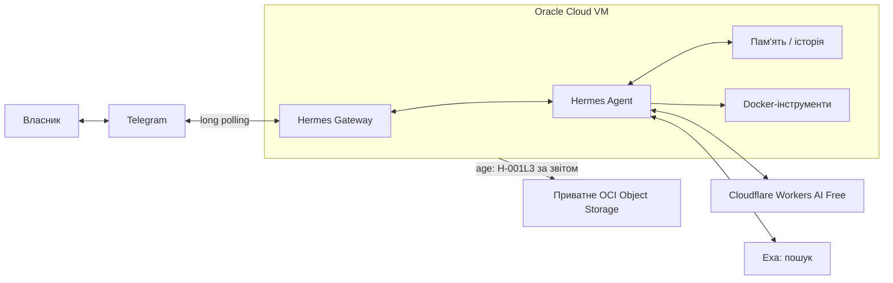

# Hermes Agent Stack

**Власний україномовний ШІ-помічник у Telegram:** пам'ятає контекст, шукає інформацію, використовує ізольовані інструменти й працює на окремому сервері, а не на ноутбуці власника.

Цей репозиторій містить не лише код, а й перевірювану історію рішень, тести, межі безпеки та інструкції продовження роботи.

**Статус · 7 листопада 2026:** основний Telegram-агент **прийнято в експлуатацію (L-006F)**. За наданим власником звітом Локального Codex **один зашифрований зовнішній backup та ізольоване відновлення пройшли (H-001L3)**. **Автоматичне резервування й моніторинг ще не запущені.** Це останній підтверджений зріз, а не онлайн-індикатор стану сервера.

[Путівник](docs/INDEX.uk.md) · [Архітектура](docs/ARCHITECTURE.uk.md) · [Розвиток](docs/ROADMAP.uk.md) · [Канонічний стан](PROJECT_STATE.md)

## Навіщо потрібен Hermes

Мета — особистий агент, доступний через звичний Telegram, із пам'яттю, пошуком джерел та можливістю виконувати контрольовані завдання. Працює незалежно від увімкненого ноутбука; доступ до Telegram-агента має лише власник.

| Можливість | Реальний статус |
| --- | --- |
| Українська мова, кілька повідомлень у контексті | Перевірено L-006F |
| Постійна пам'ять після restart і reboot | Перевірено L-006F |
| Вебпошук та джерела через Exa | Перевірено L-005, L-006F |
| Виклики інструментів в ізольованому Docker | Перевірено L-006F |
| Owner-only доступ і один Telegram poller | Перевірено L-006F / L-007A |
| Локальне резервування та isolated restore | Перевірено L-006F; свіжий ZIP L-007S перевірений за цілісністю |
| Зовнішня зашифрована копія та isolated restore | **PASS за звітом Локального Codex H-001L3**, не незалежний SSH-аудит |
| Автоматичні резерви, моніторинг, сповіщення | **Ще не ввімкнені** |

## Як це працює

На production закріплено Hermes v0.22.5, Cloudflare Workers AI Free, Exa, Oracle ARM64 і Docker sandbox без мережі. Реальні ключі й резервні архіви **не зберігаються в GitHub**. Детальніше — [архітектура та межі доступу](docs/ARCHITECTURE.uk.md).

## Ціна й обмеження

**Цільовий бюджет production — 0 грн**: без платних запасних моделей або автоматичного поповнення балансу. Безкоштовні квоти хмарних сервісів потребують реального контролю; майбутній рахунок не гарантується одним тестом. Голос, автономне керування двома Codex та автоматичне off-site резервування **не представлені як готові можливості**.

Репозиторій публічний, але сам бот — приватний. Він не є готовим однокнопковим хостингом для сторонніх користувачів.

## Звідки почати

| Хто ви | Що читати |
| --- | --- |
| Новий відвідувач | [Путівник](docs/INDEX.uk.md) · [Схема](docs/ARCHITECTURE.uk.md) |
| Хочете побачити прогрес | [Дорожня карта](docs/ROADMAP.uk.md) · [Історія](docs/CHANGELOG.uk.md) |
| Розробник або Codex | [AGENTS.md](AGENTS.md) · [CONTRIBUTING.md](CONTRIBUTING.md) |
| Оператор чи координатор | [PROJECT_STATE.md](PROJECT_STATE.md) · [PROJECT_HANDOFF.md](PROJECT_HANDOFF.md) · [Runbook](docs/RECOVERY-RUNBOOK.uk.md) |
| Перевіряєте докази | [L-006F](reports/l006f-production-ready.json) · [H-001C](reports/h001c-final-readiness.json) · [H-001L3](reports/h001l3-operator-summary.json) |

[Повна навігація й джерела](docs/INDEX.uk.md) · [Правила безпеки](SECURITY.md)
