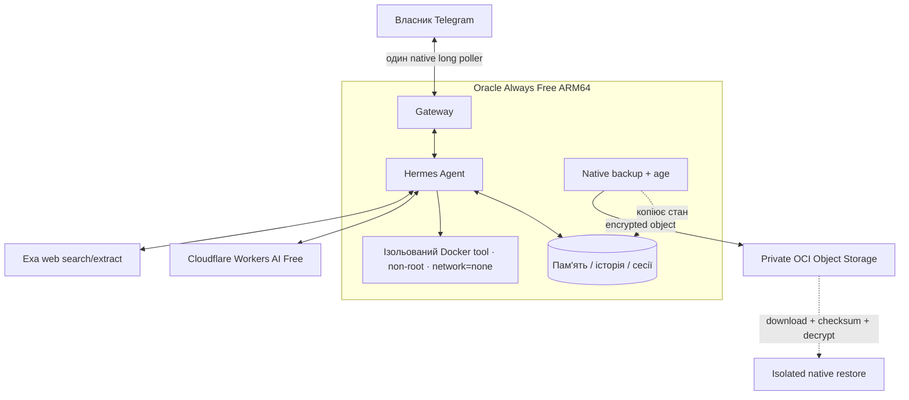

# Архітектура Hermes

**Принцип:** один приватний Telegram-агент на Oracle VM, із відокремленими провайдерами відповідей, пошуку й інструментами. Схема відображає прийнятий L-006F та пізніший H-001L3 **за звітом оператора**.

## Основні межі

**Gateway** працює через вихідне long polling, без публічного webhook-порту; доступ лише авторизованому власнику. systemd відновлює один процес після reboot. **Cloudflare Workers AI** забезпечує відповіді й планування інструментів; **Exa** — пошук та витяг інформації. Продукт не використовує платний fallback. Точні pin-моделі, upstream і plugin наведені в [PROJECT_STATE.md](../PROJECT_STATE.md).

**Docker sandbox** ізолює виконання інструментів: без мережі, без Docker socket, без host checkout та production secrets. Це не означає, що вся VM працює в контейнері.

**Пам'ять і сесії** лежать на VM. Втрата диска знищить локальні копії, тому H-001 використовує зашифровану копію в Object Storage. За звітом Local Codex один реальний цикл віддаленого резервування/відновлення пройшов, але **timer вимкнений**, а повне відновлення на новій VM не тестувалося. Важливий приватний ключ розшифрування **не має постійно бути на production VM**.

## Безпека й бюджет

- Production secrets, age private identity, SSH/OAuth keys, повні Hermes ZIP і recovery records не належать публічному GitHub.
- IAM для H-001 обмежується однією VM і конкретним bucket; читання/створення/перевірка об'єкта без надмірних прав.
- Дві копії ключа на одному пристрої **не усувають** ризик одночасної втрати обох.
- Ціль бюджету: **0 грн**, не безумовна гарантія Free Trial/Always Free. Облік місця, версій і запитів має контролюватися.
- Код у GitHub, результат імітованих тестів та реальний стан сервера — **різні речі**.

[Runtime](../scripts/hermes_runtime.py) · [Gateway guard](../deploy/gateway_guard.py) · [Backup](../scripts/offsite_backup.py) · [Restore](../scripts/offsite_restore.py) · [Стан](../PROJECT_STATE.md)
