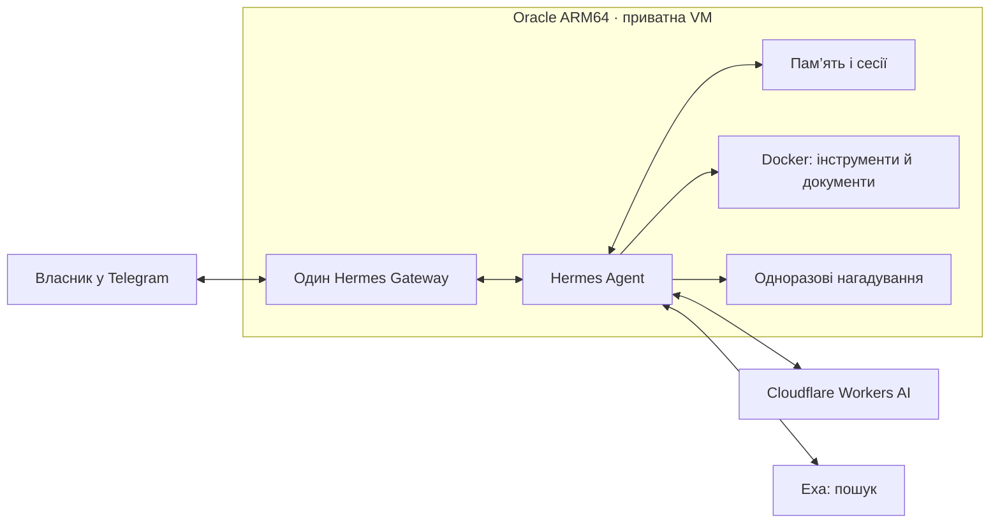

# Як влаштований Bro 👊

Bro — це персональний Telegram-агент, побудований на Hermes Agent. Його інструменти працюють на віддаленому Oracle ARM64, а не на комп’ютері власника. Схема описує архітектуру після H-004L **за звітом Локального Codex**, а не постійний онлайн-стан VM.

**Шлях повідомлення.** Telegram передає текст чи вкладення до одного штатного Gateway через long polling. Hermes обирає доступні інструменти, модель формує відповідь, Exa знаходить джерела. Для читання та створення документів використовується Docker-контейнер без мережевого доступу й без передачі секретів провайдера.

**Підключені можливості.** До початкових пам’яті, пошуку сесій і Exa додано `web_search_recent` (контроль дат), штатні `skills` та `todo` у Telegram і обмежені інструменти `bro_send_documents` та `bro_remind_once`. Наявність 53 штатних Skills у профілі **не означає**, що всі вони пройшли Telegram-тестування.

**Файли й нагадування.** Згенеровані документи надсилаються лише в особистий чат власника з обмеженого каталогу. Дозволено до трьох щойно створених файлів відповідних форматів на одну команду. Одноразове нагадування виконується через штатний планувальник без нового виклику моделі. Сценарій автоматичної доставки файлу в межах одного запиту ще не пройшов кваліфікацію.

## Безпека й експлуатація

- **Доступ:** один підтверджений власник; групи й сторонні чати вимкнені, другого Telegram poller немає.
- **Модель:** закріплено Hermes v0.22.5, Cloudflare Workers AI `@cf/zai-org/glm-4.7-flash` та keyed Exa. Платний fallback заборонено.
- **Виконання:** Docker sandbox без мережі, host checkout, Docker socket і переданих секретів. Це не означає, що вся VM ізольована Docker.
- **Резервування:** за H-001L3 повідомлено про один зашифрований OCI backup та isolated restore; повне відновлення на новій VM не доведено. Код H-002C для регулярних копій готовий у репозиторії, але **timer не ввімкнений**.
- **Бюджет:** ціль **0 грн**, але фактичні безкоштовні квоти й ризик майбутніх нарахувань потрібно контролювати.

## Де дивитися точний код та докази

[Конфігурація-шаблон](../deploy/hermes-config.json) · [обмеження доступу](../deploy/gateway_guard.py) · [інструменти Bro](../deploy/plugins/bro-capabilities/__init__.py) · [перевірка дат](../deploy/plugins/bro-recent-web/__init__.py) · [докази H-004L](H004L-BRO-CAPABILITIES.uk.md) · [план розвитку](ROADMAP.uk.md).

**Код у GitHub ≠ автоматично активна функція на сервері.** За точним станом і межами доказів звертайтеся до [PROJECT_STATE.md](../PROJECT_STATE.md).
